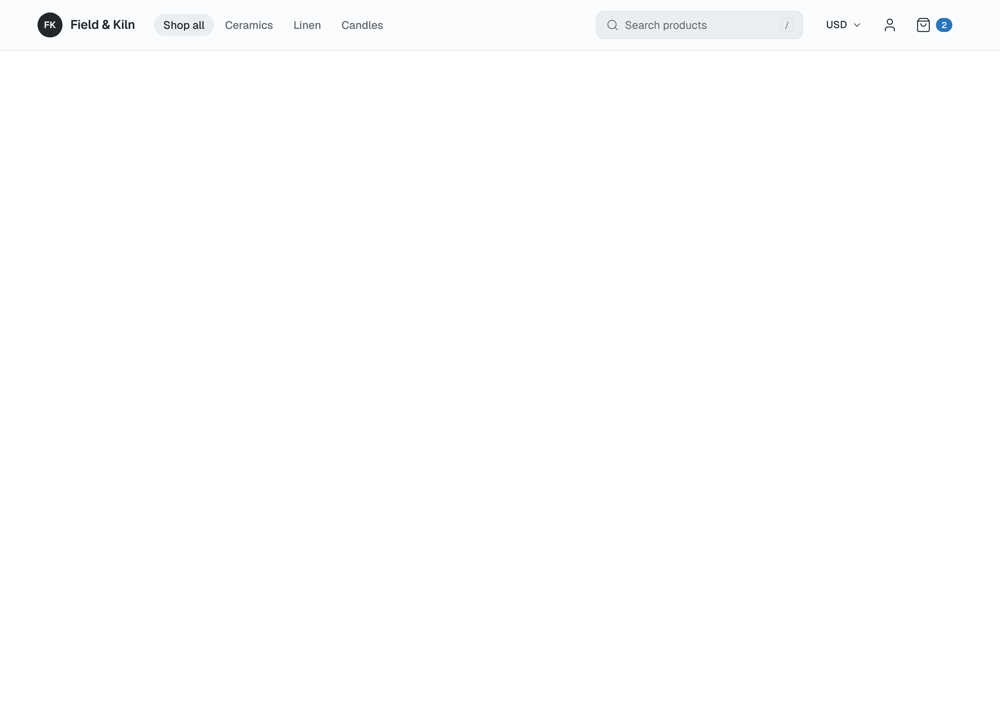

## Design

Header cart button with an item count.

**Header, desktop**

**Header, mobile**

### Spec

**Design system components:** Button (ghost neutral), Badge (solid primary sm)

- Bag icon plus a count badge; the badge hides when the cart is empty.
- Opens the cart drawer.

**Accessibility**

- `aria-label="Cart, 2 items"`.

**Tokens only:** every color, radius and size comes from `--apui-*` tokens and the component bundle; no DaisyUI classes.

Canvas boards: [Header](https://claude.ai/code/artifact/1433c967-7beb-45a4-8e05-e2785d8f8e57#artboard-Header) (part of the design for #60).
