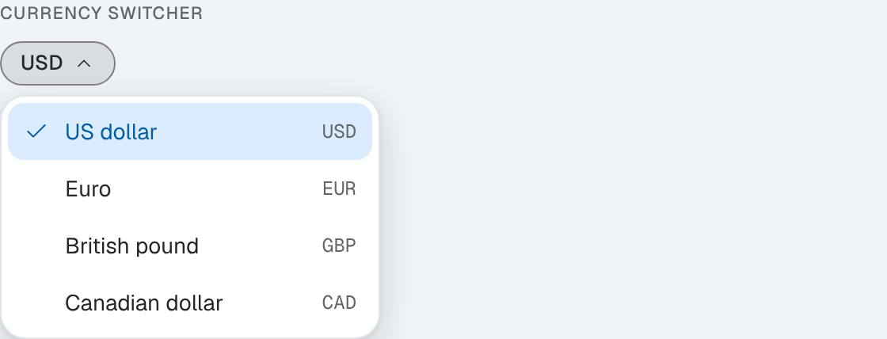
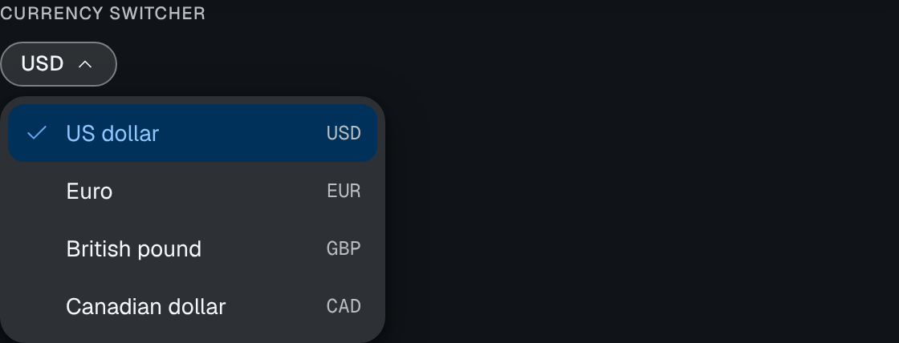

## Design

Currency switcher: a small trigger and a listbox of currencies.

**Light**

**Dark**

### Spec

**Design system components:** Button (ghost/outline neutral sm), DropdownMenu with check items

- Trigger shows the code ("USD"); the menu shows the name with the code as a mono shortcut, and a check on the current one.
- The footer has a fuller "United States · USD" trigger with a globe icon.

**Accessibility**

- `aria-haspopup="listbox"`, `aria-expanded`; items use `aria-checked`.

**Tokens only:** every color, radius and size comes from `--apui-*` tokens and the component bundle; no DaisyUI classes.

Canvas boards: [FormsSheet](https://claude.ai/code/artifact/1433c967-7beb-45a4-8e05-e2785d8f8e57#artboard-FormsSheet), [Header](https://claude.ai/code/artifact/1433c967-7beb-45a4-8e05-e2785d8f8e57#artboard-Header), [Footer](https://claude.ai/code/artifact/1433c967-7beb-45a4-8e05-e2785d8f8e57#artboard-Footer) (part of the design for #60).
