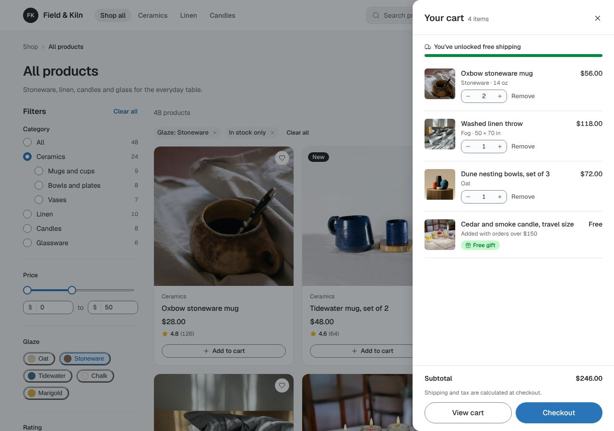
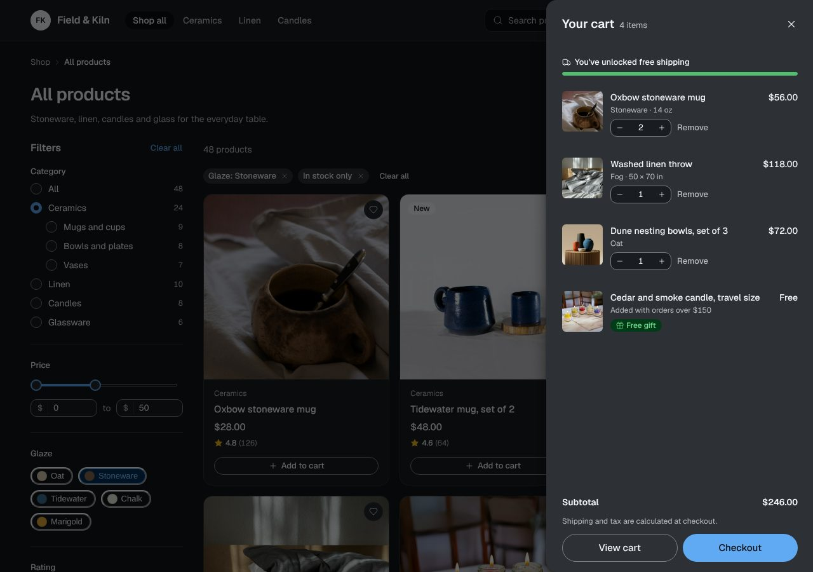
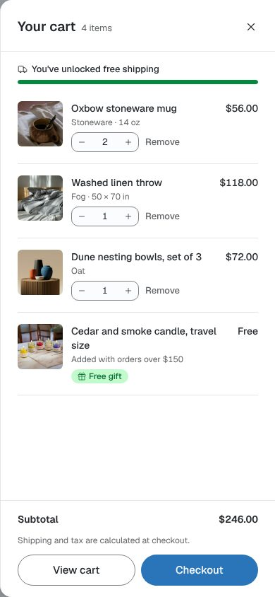

## Design

Cart drawer: an end-side drawer with lines, a free-shipping meter, the subtotal and two actions.

**Desktop, light**

**Desktop, dark**

**Mobile**

### Spec

**Design system components:** Drawer, Progress (success), Input stepper, Button, Badge

- 420px wide, full width on mobile, over the page scrim.
- Header: "Your cart" + item count + close. Body: progress meter, then lines (64px thumb, name, options, stepper, Remove link, line total). Gift lines show a "Free gift" badge and no stepper.
- Footer: Subtotal, "Shipping and tax are calculated at checkout.", View cart (outline) + Checkout (solid).

**Accessibility**

- `role="dialog" aria-modal="true"`; focus returns to the cart button when it closes.

**Tokens only:** every color, radius and size comes from `--apui-*` tokens and the component bundle; no DaisyUI classes.

Canvas boards: [CartDrawer](https://claude.ai/code/artifact/1433c967-7beb-45a4-8e05-e2785d8f8e57#artboard-CartDrawer) (part of the design for #60).
