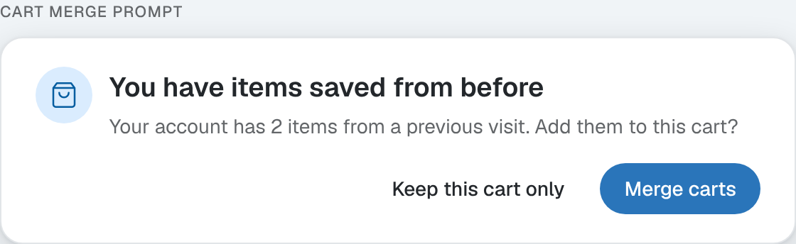
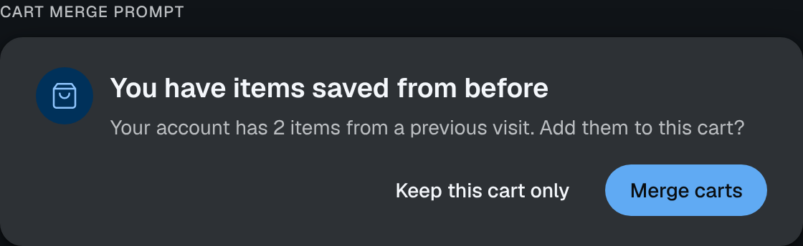

## Design

Cart merge prompt after signing in with a saved cart.

**Light**

**Dark**

### Spec

**Design system components:** Dialog (icon, title, description, footer)

- Primary action "Merge carts", secondary ghost "Keep this cart only".

**Accessibility**

- Dialog with a labelled title; focus starts on the primary action.

**Tokens only:** every color, radius and size comes from `--apui-*` tokens and the component bundle; no DaisyUI classes.

Canvas boards: [FeedbackSheet](https://claude.ai/code/artifact/1433c967-7beb-45a4-8e05-e2785d8f8e57#artboard-FeedbackSheet) (part of the design for #60).
