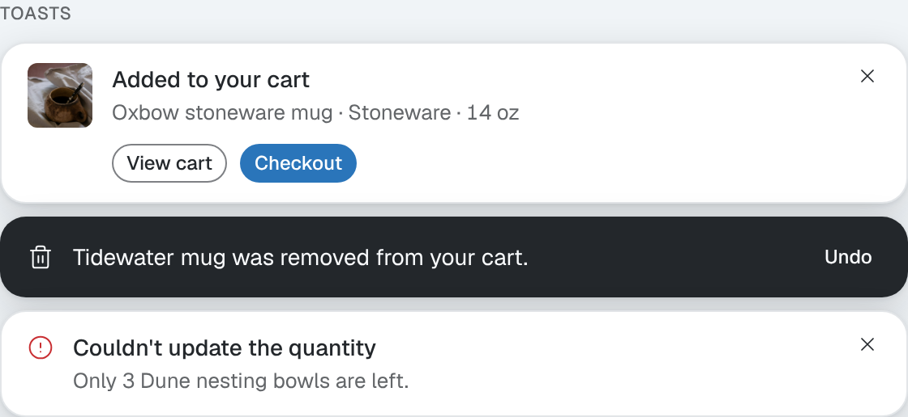
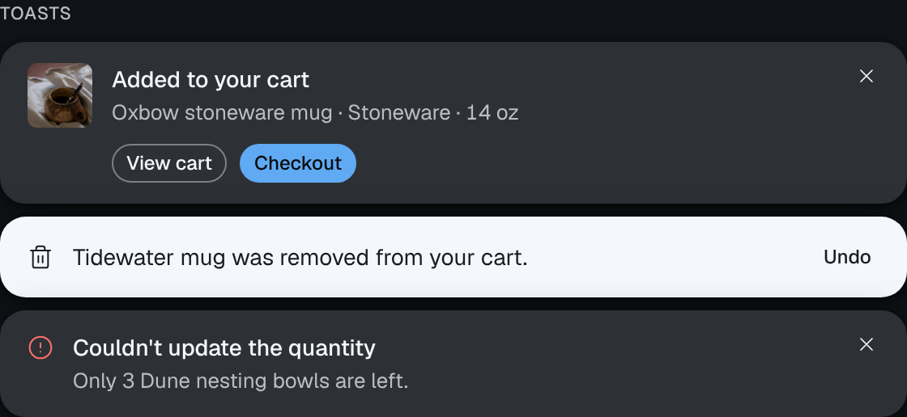

## Design

Storefront toasts: added to cart, removed with undo, and errors.

**Light**

**Dark**

### Spec

**Design system components:** Toast (default and inverse), Button

- Added to cart: product thumbnail, title, options, View cart + Checkout.
- Removed: inverse toast with Undo.
- Error: error icon, title and one line of help.
- Stack top-end on desktop, bottom on mobile.

**Accessibility**

- `role="status"` for confirmations, `role="alert"` for errors; Dismiss buttons are labelled.

**Tokens only:** every color, radius and size comes from `--apui-*` tokens and the component bundle; no DaisyUI classes.

Canvas boards: [FeedbackSheet](https://claude.ai/code/artifact/1433c967-7beb-45a4-8e05-e2785d8f8e57#artboard-FeedbackSheet) (part of the design for #60).
