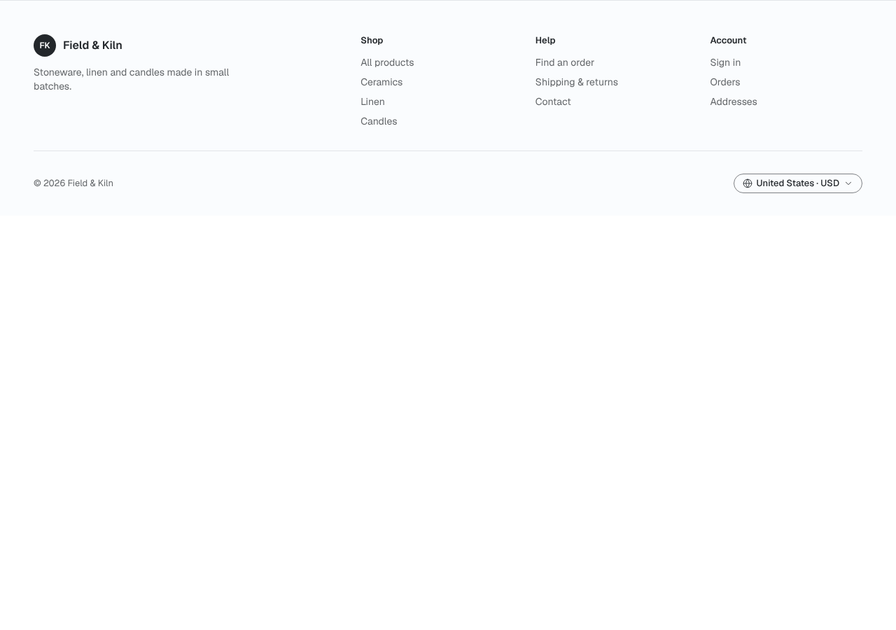
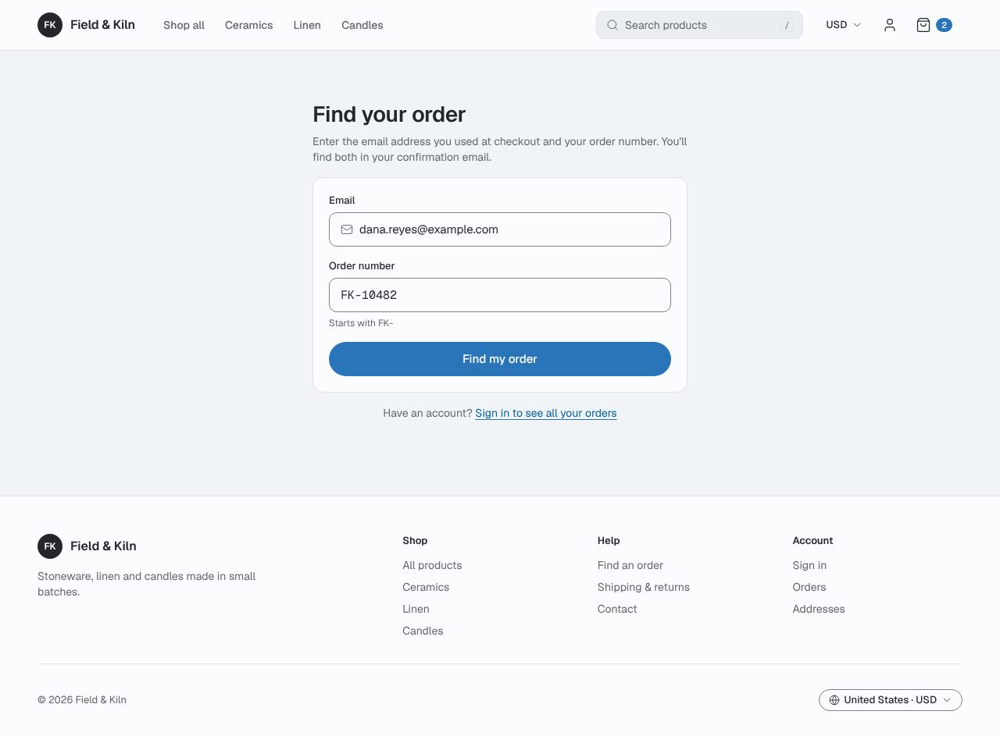

## Design

The "Ordered as a guest?" link that leads to order lookup.

**Footer**

**Order lookup**

### Spec

**Design system components:** Link (muted), Alert (neutral) on the confirmation page

- Footer Help column: "Find an order". The confirmation page repeats it as "Look up this order later" with an Order lookup button.

**Tokens only:** every color, radius and size comes from `--apui-*` tokens and the component bundle; no DaisyUI classes.

Canvas boards: [Footer](https://claude.ai/code/artifact/1433c967-7beb-45a4-8e05-e2785d8f8e57#artboard-Footer), [Lookup](https://claude.ai/code/artifact/1433c967-7beb-45a4-8e05-e2785d8f8e57#artboard-Lookup) (part of the design for #60).
